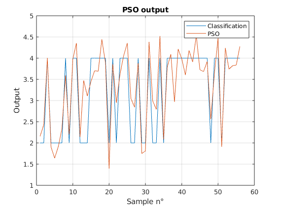

# Breast Cancer Classification with PSO and Neural Networks / Classification du cancer du sein par PSO et réseaux de neurones

🇬🇧 **EN -** This educational project studies binary classification of breast masses from 30 measurements extracted from fine-needle aspirate images. It compares a thresholded linear classifier whose weights are optimized by Particle Swarm Optimization (PSO) with feedforward neural-network experiments on the Wisconsin Diagnostic Breast Cancer (WDBC) dataset. The checked-in MATLAB script currently uses linear activations for its network; the report also describes a nonlinear-network experiment. Neither the data nor the reported results establish clinical performance.<br>

🇫🇷 **FR -** Ce projet pédagogique étudie la classification binaire de masses mammaires à partir de 30 mesures extraites d'images de ponction à l'aiguille fine. Il compare un classifieur linéaire seuillé, dont les poids sont optimisés par essaim particulaire (PSO), à des expériences avec des réseaux feedforward sur le jeu Wisconsin Diagnostic Breast Cancer (WDBC). Le script MATLAB versionné utilise actuellement des activations linéaires pour son réseau ; le rapport décrit aussi une expérience avec un réseau non linéaire. Ni les données ni les résultats présentés n'établissent une performance clinique.

[Sommaire / Contents](#sommaire--contents)



*The plot compares the PSO predictions with the reference labels in sample order. It shows the full-dataset output from the script, not an independent test evaluation.*

*Le graphique compare les prédictions du PSO aux classes de référence, dans l'ordre des échantillons. Il montre la sortie du script sur l'ensemble des données, et non une évaluation indépendante sur un jeu de test.*

## Sommaire / Contents

- [Overview / Présentation](#overview--présentation)
- [Problem and approach / Problématique et démarche](#problem-and-approach--problématique-et-démarche)
- [Technical decisions / Choix techniques](#technical-decisions--choix-techniques)
- [Results and learnings / Résultats et apprentissages](#results-and-learnings--résultats-et-apprentissages)
- [Getting started / Démarrage](#getting-started--démarrage)
- [Repository contents / Structure du dépôt](#repository-contents--structure-du-dépôt)

## Overview / Présentation

🇬🇧 **EN -** The dataset contains 569 samples: 357 benign and 212 malignant. Each sample has an ID, a diagnosis, and 30 numeric measurements: the mean, standard error, and "worst" value (mean of the three largest values) for ten nucleus characteristics: radius, texture, perimeter, area, smoothness, compactness, concavity, concave points, symmetry, and fractal dimension.

The included `data.mat` contains the 569-by-31 matrix named `data` that the script loads. Column 1 contains numeric labels (`2` = malignant, `4` = benign); the remaining columns are the 30 features. `wdbc.dat` is the source dataset, with diagnoses encoded as `M` and `B`.

<br>

🇫🇷 **FR -** Le jeu contient 569 échantillons : 357 bénins et 212 malins. Chaque échantillon comprend un identifiant, un diagnostic et 30 mesures numériques : la moyenne, l'erreur standard et la valeur « worst » (moyenne des trois valeurs les plus élevées) de dix caractéristiques des noyaux cellulaires : rayon, texture, périmètre, aire, régularité, compacité, concavité, points concaves, symétrie et dimension fractale.

Le fichier `data.mat` fourni contient la matrice `data` de 569 lignes et 31 colonnes que charge le script. La première colonne contient les classes numériques (`2` = malin, `4` = bénin) ; les 30 autres contiennent les caractéristiques. `wdbc.dat` est le jeu source, dont les diagnostics sont encodés `M` et `B`.

## Problem and approach / Problématique et démarche

🇬🇧 **EN -** The task is to map 30 measurements to one of two classes. The report describes three experiments: a feedforward network with nonlinear activations, PSO optimization of a linear classifier, and a network variant with linear activations. In each case, continuous outputs are converted to class codes 2 or 4 using a fixed threshold of 3.

The report describes training and model selection with cross-validation, followed by evaluation over all 569 samples. This full-dataset evaluation reuses samples involved in training or model selection, so it is not an independent estimate of generalization. The results section distinguishes the report's figures from what can be inferred from the versioned script.

<br>

🇫🇷 **FR -** L'objectif est de transformer 30 mesures en une prédiction parmi deux classes. Le rapport décrit trois expériences : un réseau feedforward avec des activations non linéaires, l'optimisation PSO d'un classifieur linéaire et une variante du réseau avec des activations linéaires. Dans chaque cas, les sorties continues sont converties en codes de classe 2 ou 4 à l'aide d'un seuil fixe de 3.

Le rapport décrit un entraînement et une sélection par validation croisée, suivis d'une évaluation sur les 569 échantillons. Cette évaluation globale réutilise les données ayant servi à l'entraînement ou à la sélection ; elle ne fournit donc pas une estimation indépendante de la généralisation. La section des résultats distingue les chiffres du rapport de ce que permet d'établir le script versionné.

## Technical decisions / Choix techniques


🇬🇧 **EN -** The report compares a feedforward network with 30 hidden units, trained by backpropagation using Levenberg–Marquardt (`trainlm`) and mean squared error (MSE). It describes 20-fold cross-validation for the network. A linear variant changes the hidden and output transfer functions to `purelin`. PSO optimizes the 30 weights of a thresholded weighted sum using 10-fold cross-validation.

`lab4.m` loads `data.mat`, uses `cvpartition`, `feedforwardnet`, `trainlm`, `perform`, and `confusionmat`, then displays plots and confusion matrices. The threshold is 3, the midpoint of class codes 2 and 4. A min-max normalization helper is present but is not called for either model: features remain at their original, substantially different scales. The report says the data is normalized; that is not what the checked-in script does.

The current script explicitly sets `purelin` for both the hidden and output layers. Their composition is still linear, so this network cannot learn a nonlinear decision boundary. The network is created before the cross-validation loop and the same object is trained again from fold to fold rather than initializing an independent model for each fold. Also, `best_perf` is never updated: the condition intended to retain the best network is true on every fold, and `bestNet` ends up containing the network from the final fold.

PSO follows the usual velocity and position updates based on each particle's personal best and the swarm's global best. The parameters in `lab4.m` are 50 particles, up to 1,000 iterations, inertia decreasing from 0.9 to 0.4, and coefficients `c1 = 1.7`, `c2 = 1.75`. The report mentions 100 particles and equal random factors; these statements do not match the current code, which uses 50 particles and draws `r1` and `r2` independently. The weights start randomly and are not constrained after updates. The early-stop condition `MSE < 0.1` is checked before the current particle is recorded as a personal or global best, so a qualifying candidate may be skipped. The code then chooses the fold result with the lowest test MSE and evaluates those weights on the full dataset; that final evaluation is not independent.

<br>

🇫🇷 **FR -** Le rapport compare un réseau feedforward avec 30 neurones cachés, entraîné par rétropropagation avec l'algorithme de Levenberg–Marquardt (`trainlm`) et l'erreur quadratique moyenne (MSE). Il décrit une validation croisée à 20 partitions pour le réseau. Une variante linéaire utilise `purelin` pour les fonctions de transfert des couches cachée et de sortie. Le PSO optimise les 30 poids d'une somme pondérée seuillée avec une validation croisée à 10 partitions.

`lab4.m` charge `data.mat`, utilise `cvpartition`, `feedforwardnet`, `trainlm`, `perform` et `confusionmat`, puis affiche des graphiques et des matrices de confusion. Le seuil est 3, le milieu entre les codes de classe 2 et 4. Une fonction de normalisation min-max est présente mais n'est appelée pour aucun des deux modèles : les caractéristiques gardent leurs échelles d'origine, très différentes. Le rapport indique que les données sont normalisées ; ce n'est pas le comportement du script versionné.

Le script actuel définit explicitement `purelin` pour les couches cachée et de sortie. Leur composition reste linéaire : ce réseau ne peut donc pas apprendre une frontière de décision non linéaire. Le réseau est créé avant la boucle de validation croisée, puis le même objet est réentraîné d'une partition à l'autre, au lieu d'initialiser un modèle indépendant par partition. De plus, `best_perf` n'est jamais mis à jour : la condition censée conserver le meilleur réseau est vraie à chaque partition et `bestNet` contient finalement le réseau de la dernière partition.

Le PSO suit les mises à jour habituelles de la vitesse et de la position à partir du meilleur résultat personnel de chaque particule et du meilleur résultat global de l'essaim. Dans `lab4.m`, les paramètres sont 50 particules, jusqu'à 1 000 itérations, une inertie décroissant de 0,9 à 0,4 et les coefficients `c1 = 1,7`, `c2 = 1,75`. Le rapport mentionne 100 particules et des facteurs aléatoires égaux ; cela ne correspond pas au code actuel, qui utilise 50 particules et tire `r1` et `r2` indépendamment. Les poids sont initialisés aléatoirement et ne sont pas contraints après leurs mises à jour. La condition d'arrêt anticipé `MSE < 0.1` est vérifiée avant d'enregistrer la particule comme meilleur résultat personnel ou global ; un candidat satisfaisant ce seuil peut donc être ignoré. Le code choisit ensuite le résultat de partition ayant la MSE de test la plus faible, puis évalue ces poids sur l'ensemble des données : cette évaluation finale n'est pas indépendante.

## Results and learnings / Résultats et apprentissages

🇬🇧 **EN -** The report gives the following results for its experiments. The matrices list actual and predicted classes in the order `2` (malignant), `4` (benign):

| Experiment | Reported result or calculation | Archived confusion matrix |
| --- | ---: | ---: |
| Feedforward network described as nonlinear in the report | 564/569 = 99.12% | `[[207, 5], [0, 357]]` |
| PSO | 555/569 = 97.53% in the report; 97.54% from the counts | `[[201, 11], [3, 354]]` |
| Linear-activation network | 96.31% in the report; 547/569 = 96.13% from its archived matrix | `[[191, 21], [1, 356]]` |

The corresponding matrices are available for the [network](medias/nn_confusion_matrix.png), [PSO](medias/pso_confusion_matrix.png), and [linear network](medias/nn_linear_confusion_matrix.png). The report contradicts itself about the network: it mentions five malignant samples predicted as benign, then claims there were none; the archived matrix confirms five such errors. For PSO, the report states that three malignant samples were predicted as benign; however, reading the archived matrix in actual/predicted class order `2`, `4` shows 11 such errors. The linear-network matrix shows 21 malignant samples predicted as benign and one benign sample predicted as malignant. The image labels are `1` and `2` because the charts were generated from matrix counts; they correspond to classes `2` and `4`, respectively. These differences matter because overall accuracy alone does not show which class is misclassified.

These figures are not an independent evaluation and must not be interpreted as clinical performance. The report's 96.31% for the linear network also differs from the 547 correct predictions out of 569 visible in its archived matrix (96.13%). Finally, the currently versioned script explicitly sets linear activations, so it does not directly reproduce the nonlinear-network experiment associated with the report's 99.12%. The saved figures represent different experiments and are not all outputs of one consistent run of the current script.

A more reliable comparison would fit an independent model in each fold, update best-model selection correctly, fit normalization only on training data, and reserve a final test set or use nested cross-validation. It should also fix random seeds, preserve experiment settings alongside saved figures, and report per-class metrics in addition to accuracy, given the class imbalance.

<br>

🇫🇷 **FR -** Le rapport présente les résultats suivants pour ses expériences. Les matrices indiquent les classes réelles puis prédites dans l'ordre `2` (malin), `4` (bénin) :

| Expérience | Résultat rapporté ou calculé | Matrice de confusion archivée |
| --- | ---: | ---: |
| Réseau feedforward décrit comme non linéaire dans le rapport | 564/569 = 99,12 % | `[[207, 5], [0, 357]]` |
| PSO | 555/569 = 97,53 % dans le rapport ; 97,54 % d'après les comptes | `[[201, 11], [3, 354]]` |
| Réseau à activations linéaires | 96,31 % dans le rapport ; 547/569 = 96,13 % d'après sa matrice archivée | `[[191, 21], [1, 356]]` |

Les matrices correspondantes sont disponibles pour le [réseau](medias/nn_confusion_matrix.png), le [PSO](medias/pso_confusion_matrix.png) et le [réseau linéaire](medias/nn_linear_confusion_matrix.png). Le rapport se contredit au sujet du réseau : il mentionne cinq échantillons malins prédits bénins, puis affirme qu'il n'y en a aucun ; la matrice archivée confirme cinq erreurs de ce type. Pour le PSO, le rapport indique trois échantillons malins prédits bénins ; toutefois, la matrice archivée, lue dans l'ordre des classes réelles et prédites `2`, `4`, en montre 11. La matrice du réseau linéaire montre 21 échantillons malins prédits bénins et un échantillon bénin prédit malin. Les graphiques affichent les étiquettes `1` et `2`, car ils sont tracés à partir des comptes matriciels ; elles correspondent respectivement aux classes `2` et `4`. Ces écarts sont importants, car l'exactitude globale ne montre pas quelle classe est mal classée.

Ces chiffres ne constituent pas une évaluation indépendante et ne doivent pas être interprétés comme une performance clinique. Les 96,31 % annoncés dans le rapport pour le réseau linéaire diffèrent aussi des 547 prédictions correctes sur 569 visibles dans sa matrice archivée (96,13 %). Enfin, le script actuellement versionné impose des activations linéaires ; il ne reproduit donc pas directement l'expérience de réseau non linéaire associée aux 99,12 % du rapport. Les figures sauvegardées représentent différentes expériences et ne proviennent pas toutes d'une même exécution cohérente du script actuel.

Une comparaison plus fiable consisterait à entraîner un modèle indépendant dans chaque partition, à corriger la sélection du meilleur modèle, à ajuster la normalisation uniquement sur les données d'entraînement, puis à réserver un jeu de test final ou à utiliser une validation croisée imbriquée. Il faudrait également fixer les graines aléatoires, conserver les paramètres des expériences avec les figures sauvegardées et rapporter des métriques par classe en plus de l'exactitude, compte tenu du déséquilibre des classes.

## Getting started

### Requirements

- MATLAB
- Deep Learning Toolbox (formerly Neural Network Toolbox)
- Statistics and Machine Learning Toolbox

MATLAB, Deep Learning Toolbox (anciennement Neural Network Toolbox) et Statistics and Machine Learning Toolbox sont nécessaires.

### Run

1. Clone this repository and open its directory in MATLAB.
2. Run the command from the repository root, where the included `data.mat` is located. The script loads this file directly.
3. Run:

```matlab
run("lab4.m")
```

The script prints fold MSEs and class-distribution summaries in the MATLAB command window, then opens output plots and confusion charts. It does not automatically save newly trained models or figures. Results may vary between runs because cross-validation partitions and PSO initialization are random and no random seed is set.


## Repository contents / Structure du dépôt

- `lab4.m`: training, cross-validation, PSO optimization, and plots.
- `data.mat`: numeric matrix loaded by the script.
- `bestNet.mat`: saved network file; it is not loaded by `lab4.m`.
- `wdbc.dat` and `opis.txt`: source dataset and dataset description.
- `VAJA4.pdf` and `ISDS_VAJA4.pdf`: assignment brief and project report.
- `medias/`: saved output plots and confusion matrices.

- `lab4.m` : entraînement, validation croisée, optimisation PSO et graphiques.
- `data.mat` : matrice numérique chargée par le script.
- `bestNet.mat` : fichier contenant un réseau sauvegardé ; `lab4.m` ne le charge pas.
- `wdbc.dat` et `opis.txt` : jeu de données source et sa description.
- `VAJA4.pdf` et `ISDS_VAJA4.pdf` : consignes du travail et rapport du projet.
- `medias/` : graphiques et matrices de confusion sauvegardés.
