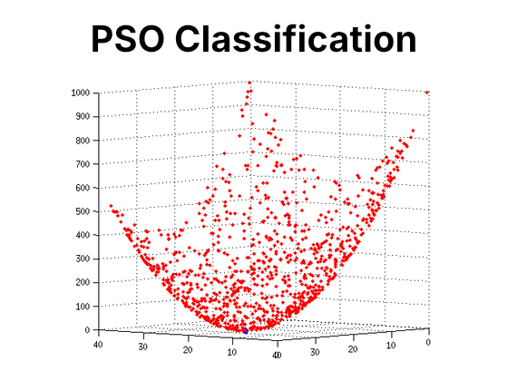
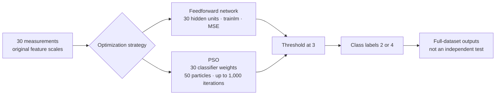
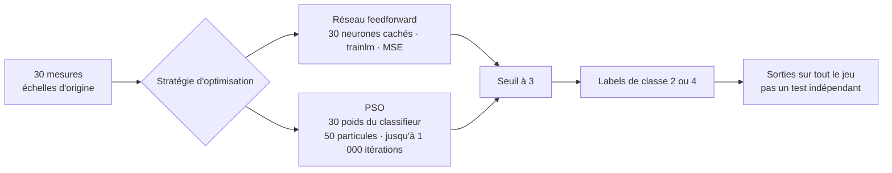

<p align="center">
  
</p>

<h1 align="center">PSO Classification</h1>

<!--<p align="left">
  <strong>🇬🇧 EN - </strong> A comparison of breast-cancer classification methods based on particle-swarm optimisation and neural networks.<br>
  <strong>🇫🇷 FR - </strong> Étude comparative de méthodes de classification du cancer du sein, fondées sur l’optimisation par essaim particulaire et les réseaux de neurones.
</p>-->


🇬🇧 **EN -** This project benchmarks two optimization strategies for binary classification of breast masses using 30 image-derived measurements from the Wisconsin Diagnostic Breast Cancer (WDBC) dataset. It contrasts a thresholded linear classifier optimized by Particle Swarm Optimization (PSO) with feedforward neural-network experiments, with emphasis on training dynamics and optimization behavior rather than clinical use.<br>

🇫🇷 **FR -** Ce projet compare deux stratégies d'optimisation pour la classification binaire de masses mammaires à partir de 30 mesures issues d'images du jeu de données Wisconsin Diagnostic Breast Cancer (WDBC). Il oppose un classifieur linéaire seuillé optimisé par essaim particulaire (PSO) à des expériences avec des réseaux feedforward, en mettant l'accent sur la dynamique d'entraînement et le comportement d'optimisation plutôt que sur une utilisation clinique.

[← Back to portfolio](https://mlmdc.github.io/mlmdc_portfolio/) · [Sommaire / Contents](#sommaire--contents)


## Sommaire / Contents

- [Overview / Présentation](#overview--présentation)
- [Problem and approach / Problématique et démarche](#problem-and-approach--problématique-et-démarche)
- [Technical decisions / Choix techniques](#technical-decisions--choix-techniques)
- [Results and learnings / Résultats et apprentissages](#results-and-learnings--résultats-et-apprentissages)
- [Getting started / Démarrage](#getting-started--démarrage)
- [Repository contents / Structure du dépôt](#repository-contents--structure-du-dépôt)

## Overview / Présentation

🇬🇧 **EN -** The dataset contains 569 samples: 357 benign and 212 malignant. Each sample has an ID, a diagnosis, and 30 numeric measurements: the mean, standard error, and "worst" value (mean of the three largest values) for ten nucleus characteristics: radius, texture, perimeter, area, smoothness, compactness, concavity, concave points, symmetry, and fractal dimension.

The included `wdbc_data.mat` contains the 569-by-31 matrix named `data` that the script loads. Column 1 contains numeric labels (`2` = malignant, `4` = benign); the remaining columns are the 30 features. `wdbc.dat` is the source dataset, with diagnoses encoded as `M` and `B`.

<br>

🇫🇷 **FR -** Le jeu contient 569 échantillons : 357 bénins et 212 malins. Chaque échantillon comprend un identifiant, un diagnostic et 30 mesures numériques : la moyenne, l'erreur standard et la valeur « worst » (moyenne des trois valeurs les plus élevées) de dix caractéristiques des noyaux cellulaires : rayon, texture, périmètre, aire, régularité, compacité, concavité, points concaves, symétrie et dimension fractale.

Le fichier `wdbc_data.mat` fourni contient la matrice `data` de 569 lignes et 31 colonnes que charge le script. La première colonne contient les classes numériques (`2` = malin, `4` = bénin) ; les 30 autres contiennent les caractéristiques. `wdbc.dat` est le jeu source, dont les diagnostics sont encodés `M` et `B`.

## Problem and approach / Problématique et démarche

🇬🇧 **EN -** The objective is to classify 569 breast-mass samples into two classes from 30 measurements. The project compares three model variants: a feedforward network with nonlinear activations, a PSO-optimized linear classifier, and a linear-activation network variant. In each case, continuous outputs are converted to class labels 2 or 4 using a fixed threshold of 3.

Training and model selection rely on cross-validation, followed by evaluation on the full dataset. Because those samples are reused in the final assessment, the resulting figures should be interpreted as comparative project outcomes rather than an independent estimate of generalization.

<br>

🇫🇷 **FR -** L'objectif est de classer 569 échantillons de masses mammaires en deux classes à partir de 30 mesures. Le projet compare trois variantes de modèles : un réseau feedforward avec activations non linéaires, un classifieur linéaire optimisé par PSO, et une variante de réseau à activations linéaires. Dans chaque cas, les sorties continues sont converties en labels 2 ou 4 selon un seuil fixe de 3.

L'entraînement et la sélection du modèle reposent sur une validation croisée, suivie d'une évaluation sur l'ensemble du jeu de données. Comme ces échantillons sont réutilisés dans l'évaluation finale, les résultats doivent être interprétés comme des performances comparatives du projet, et non comme une estimation indépendante de la généralisation.

## Technical decisions / Choix techniques

🇬🇧 **EN - Two optimization strategies, one classification task.** The project compares how a feedforward network and Particle Swarm Optimization (PSO) map the same 30 measurements to a binary decision. The network learns through backpropagation; PSO directly searches for the weights of a thresholded linear classifier.



- **The comparison focuses on optimization behavior.** The network uses Levenberg–Marquardt (`trainlm`) and 20-fold cross-validation; PSO uses 10-fold cross-validation. Both methods ultimately classify with a threshold of 3, midway between class labels 2 and 4.
- **The current implementation is linear.** `PSO_NN_bc.m` assigns `purelin` to both layers, so the implemented network is effectively linear. Features are also left in their original scale despite an unused min-max helper.
- **The reported scores should be interpreted carefully.** The same network is reused across folds, and best-model selection is not updated consistently; final figures are then computed on the full dataset. This limits the reliability of the comparison as a generalization study.

<br>

🇫🇷 **FR - Deux stratégies d'optimisation, une même tâche de classification.** Le projet compare la façon dont un réseau feedforward et l'optimisation par essaim particulaire (PSO) transforment les mêmes 30 mesures en une décision binaire. Le réseau apprend par rétropropagation ; le PSO cherche directement les poids d'un classifieur linéaire seuillé.



- **La comparaison met l'accent sur l'optimisation.** Le réseau utilise Levenberg–Marquardt (`trainlm`) avec validation croisée à 20 partitions ; le PSO utilise 10 partitions. Les deux méthodes classent finalement à l'aide d'un seuil de 3, situé à mi-chemin entre les labels de classe 2 et 4.
- **L'implémentation actuelle est linéaire.** `PSO_NN_bc.m` attribue `purelin` aux deux couches, de sorte que le réseau implémenté est essentiellement linéaire. Les caractéristiques restent aussi dans leur échelle d'origine, malgré la présence d'un helper min-max non utilisé.
- **Les performances rapportées doivent être interprétées avec prudence.** Le même réseau est réutilisé entre partitions, et la sélection du meilleur modèle n'est pas correctement mise à jour ; les figures finales sont ensuite calculées sur l'ensemble du jeu de données. Cela limite la fiabilité de la comparaison comme étude de généralisation.

## Results and learnings / Résultats et apprentissages

🇬🇧 **EN - Accuracy alone is not enough.** The figures look strong, but they come from experiments that are not consistently reproduced, and overall accuracy can hide critical errors on malignant cases.

| Experiment | Result |
| --- | ---: |
| Feedforward network with nonlinear activations | 564/569 = 99.12% |
| PSO | 555/569 = 97.53% in project notes; 97.54% from counts |
| Linear-activation network | 547/569 = 96.13% from saved confusion matrix |

The available confusion matrices for the [network](medias/nn_confusion_matrix.png), [PSO](medias/pso_confusion_matrix.png), and [linear network](medias/nn_linear_confusion_matrix.png) show why raw accuracy can be misleading: malignant cases classified as benign range from 5 to 21 depending on the experiment. The confusion-chart labels `1` and `2` correspond to class labels `2` and `4`.

These results should be read as project outputs, not as a reliable estimate of generalization or clinical performance. The current implementation is linear, so it does not reproduce the nonlinear network behind the 99.12% figure, and the archived plots reflect different experiment settings. A stronger benchmark would isolate each fold with its own model, fix random seeds, normalize from training data only, and reserve an independent test set or nested validation loop. Per-class metrics would make the false-negative burden much clearer.

<br>

🇫🇷 **FR - Une forte précision ne suffit pas.** Les chiffres paraissent bons, mais ils proviennent d'expériences qui ne sont pas reproduites de façon cohérente, et l'exactitude globale peut masquer des erreurs critiques sur les cas malins.

| Expérience | Résultat |
| --- | ---: |
| Réseau feedforward avec activations non linéaires | 564/569 = 99,12 % |
| PSO | 555/569 = 97,53 % selon les notes du projet ; 97,54 % d'après les comptes |
| Réseau à activations linéaires | 547/569 = 96,13 % d'après la matrice enregistrée |

Les matrices de confusion disponibles pour le [réseau](medias/nn_confusion_matrix.png), le [PSO](medias/pso_confusion_matrix.png) et le [réseau linéaire](medias/nn_linear_confusion_matrix.png) montrent pourquoi l'exactitude brute peut être trompeuse : les cas malins classés comme bénins varient de 5 à 21 selon l'expérience. Les étiquettes `1` et `2` des graphiques de confusion correspondent aux labels de classe `2` et `4`.

Ces résultats doivent être interprétés comme des sorties du projet, et non comme une estimation fiable de la généralisation ou de la performance clinique. L'implémentation actuelle est linéaire, de sorte qu'elle ne reproduit pas le réseau non linéaire associé au score de 99,12 %, et les figures archivées reflètent des configurations expérimentales différentes. Un benchmark plus solide utiliserait un modèle indépendant par partition, fixerait les graines aléatoires, normaliserait à partir des seules données d'entraînement et réserverait un jeu de test indépendant ou une validation imbriquée. Des métriques par classe rendraient le coût des faux négatifs beaucoup plus lisible.

## Getting started

### Requirements

- MATLAB
- Deep Learning Toolbox (formerly Neural Network Toolbox)
- Statistics and Machine Learning Toolbox

MATLAB, Deep Learning Toolbox (anciennement Neural Network Toolbox) et Statistics and Machine Learning Toolbox sont nécessaires.

### Run

1. Clone this repository and open its directory in MATLAB.
2. Run the command from the repository root, where the included `wdbc_data.mat` is located. The script loads this file directly.
3. Run:

```matlab
run("PSO_NN_bc.m")
```

The script prints fold MSEs and class-distribution summaries in the MATLAB command window, then opens output plots and confusion charts. It does not automatically save newly trained models or figures. Results may vary between runs because cross-validation partitions and PSO initialization are random and no random seed is set.


## Repository contents / Structure du dépôt

```text
.
├── LICENSE
├── README.md
├── PSO_NN_bc.m
├── best_network.mat
├── wdbc.dat
├── wdbc_data.mat
└── medias/
    ├── Feedforward_linear_output.png
    ├── Feedforward_output.png
    ├── PSO_output.png
    ├── nn_confusion_matrix.png
    ├── nn_linear_confusion_matrix.png
    ├── pso_confusion_matrix.png
    ├── sorted_linear.png
    └── sorted_nonlinear.png
```

`PSO_NN_bc.m` contains the training, cross-validation, PSO optimization, and plot generation. `wdbc_data.mat` is the matrix loaded by the script; `best_network.mat` is a saved network that the script does not load. `wdbc.dat` is the source dataset, and `medias/` contains the plots and confusion matrices.

`PSO_NN_bc.m` contient l'entraînement, la validation croisée, l'optimisation PSO et la génération des graphiques. `wdbc_data.mat` est la matrice chargée par le script ; `best_network.mat` est un réseau sauvegardé, mais le script ne le charge pas. `wdbc.dat` est le jeu de données source et `medias/` regroupe les graphiques et matrices de confusion.

## License

This project is licensed under the MIT License. See the [LICENSE](LICENSE) file for details.
