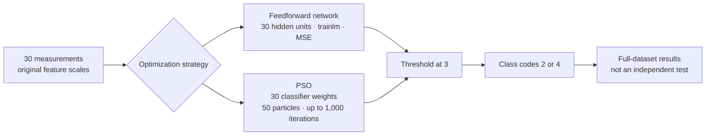
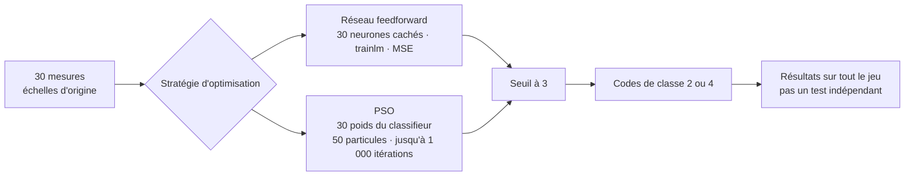

# Breast Cancer Classification with PSO and Neural Networks / Classification du cancer du sein par PSO et réseaux de neurones

🇬🇧 **EN -** This educational project studies binary classification of breast masses from 30 measurements extracted from fine-needle aspirate images. It compares a thresholded linear classifier whose weights are optimized by Particle Swarm Optimization (PSO) with feedforward neural-network experiments on the Wisconsin Diagnostic Breast Cancer (WDBC) dataset. The checked-in MATLAB script currently uses linear activations for its network; the report also describes a nonlinear-network experiment. Neither the data nor the reported results establish clinical performance.<br>

🇫🇷 **FR -** Ce projet pédagogique étudie la classification binaire de masses mammaires à partir de 30 mesures extraites d'images de ponction à l'aiguille fine. Il compare un classifieur linéaire seuillé, dont les poids sont optimisés par essaim particulaire (PSO), à des expériences avec des réseaux feedforward sur le jeu Wisconsin Diagnostic Breast Cancer (WDBC). Le script MATLAB versionné utilise actuellement des activations linéaires pour son réseau ; le rapport décrit aussi une expérience avec un réseau non linéaire. Ni les données ni les résultats présentés n'établissent une performance clinique.

[Sommaire / Contents](#sommaire--contents)


*The plot compares the PSO predictions with the reference labels in sample order. It shows the full-dataset output from the script, not an independent test evaluation.*

*Le graphique compare les prédictions du PSO aux classes de référence, dans l'ordre des échantillons. Il montre la sortie du script sur l'ensemble des données, et non une évaluation indépendante sur un jeu de test.*

## Sommaire / Contents

- [Overview / Présentation](#overview--présentation)
- [Problem and approach / Problématique et démarche](#problem-and-approach--problématique-et-démarche)
- [Technical decisions / Choix techniques](#technical-decisions--choix-techniques)
- [Results and learnings / Résultats et apprentissages](#results-and-learnings--résultats-et-apprentissages)
- [Getting started / Démarrage](#getting-started--démarrage)
- [Repository contents / Structure du dépôt](#repository-contents--structure-du-dépôt)

## Overview / Présentation

🇬🇧 **EN -** The dataset contains 569 samples: 357 benign and 212 malignant. Each sample has an ID, a diagnosis, and 30 numeric measurements: the mean, standard error, and "worst" value (mean of the three largest values) for ten nucleus characteristics: radius, texture, perimeter, area, smoothness, compactness, concavity, concave points, symmetry, and fractal dimension.

The included `wdbc_data.mat` contains the 569-by-31 matrix named `data` that the script loads. Column 1 contains numeric labels (`2` = malignant, `4` = benign); the remaining columns are the 30 features. `wdbc.dat` is the source dataset, with diagnoses encoded as `M` and `B`.

<br>

🇫🇷 **FR -** Le jeu contient 569 échantillons : 357 bénins et 212 malins. Chaque échantillon comprend un identifiant, un diagnostic et 30 mesures numériques : la moyenne, l'erreur standard et la valeur « worst » (moyenne des trois valeurs les plus élevées) de dix caractéristiques des noyaux cellulaires : rayon, texture, périmètre, aire, régularité, compacité, concavité, points concaves, symétrie et dimension fractale.

Le fichier `wdbc_data.mat` fourni contient la matrice `data` de 569 lignes et 31 colonnes que charge le script. La première colonne contient les classes numériques (`2` = malin, `4` = bénin) ; les 30 autres contiennent les caractéristiques. `wdbc.dat` est le jeu source, dont les diagnostics sont encodés `M` et `B`.

## Problem and approach / Problématique et démarche

🇬🇧 **EN -** The task is to map 30 measurements to one of two classes. The report describes three experiments: a feedforward network with nonlinear activations, PSO optimization of a linear classifier, and a network variant with linear activations. In each case, continuous outputs are converted to class codes 2 or 4 using a fixed threshold of 3.

The report describes training and model selection with cross-validation, followed by evaluation over all 569 samples. This full-dataset evaluation reuses samples involved in training or model selection, so it is not an independent estimate of generalization. The results section distinguishes the report's figures from what can be inferred from the versioned script.

<br>

🇫🇷 **FR -** L'objectif est de transformer 30 mesures en une prédiction parmi deux classes. Le rapport décrit trois expériences : un réseau feedforward avec des activations non linéaires, l'optimisation PSO d'un classifieur linéaire et une variante du réseau avec des activations linéaires. Dans chaque cas, les sorties continues sont converties en codes de classe 2 ou 4 à l'aide d'un seuil fixe de 3.

Le rapport décrit un entraînement et une sélection par validation croisée, suivis d'une évaluation sur les 569 échantillons. Cette évaluation globale réutilise les données ayant servi à l'entraînement ou à la sélection ; elle ne fournit donc pas une estimation indépendante de la généralisation. La section des résultats distingue les chiffres du rapport de ce que permet d'établir le script versionné.

## Technical decisions / Choix techniques

🇬🇧 **EN - Two optimization strategies, one classification task.** The project compares how a feedforward network and Particle Swarm Optimization (PSO) turn the same 30 measurements into one of two classes. The network learns through backpropagation; PSO searches directly for the weights of a thresholded linear classifier.



- **The comparison is about the optimizer, not just the model.** The network uses Levenberg–Marquardt (`trainlm`) and the report describes 20-fold cross-validation; PSO uses 10-fold cross-validation. Both ultimately classify with a threshold of 3, halfway between class codes 2 and 4.
- **The checked-in implementation is the source of truth.** `PSO_NN_bc.m` sets both network layers to `purelin`, so the implemented network is linear—even though the report also describes a nonlinear experiment. It also leaves features unnormalized, despite including an unused min-max helper.
- **The scores need qualification.** The network is reused across folds and best-model selection is not correctly updated; final figures are then produced on the full dataset. These choices mean the reported results are not a clean, independent comparison of generalization.

<br>

🇫🇷 **FR - Deux stratégies d'optimisation, une même tâche de classification.** Le projet compare la façon dont un réseau feedforward et l'optimisation par essaim particulaire (PSO) transforment les mêmes 30 mesures en l'une des deux classes. Le réseau apprend par rétropropagation ; le PSO recherche directement les poids d'un classifieur linéaire seuillé.



- **La comparaison porte sur l'optimisation, pas seulement sur le modèle.** Le réseau utilise Levenberg–Marquardt (`trainlm`) et le rapport décrit une validation croisée à 20 partitions ; le PSO utilise 10 partitions. Les deux méthodes classent finalement à l'aide d'un seuil de 3, situé à mi-chemin entre les codes de classe 2 et 4.
- **Le code versionné fait foi.** `PSO_NN_bc.m` définit `purelin` pour les deux couches du réseau : l'implémentation est donc linéaire, même si le rapport décrit aussi une expérience non linéaire. Les caractéristiques ne sont pas normalisées, malgré la présence d'une fonction min-max qui n'est pas utilisée.
- **Les résultats doivent être nuancés.** Le réseau est réutilisé d'une partition à l'autre et la sélection du meilleur modèle n'est pas correctement mise à jour ; les résultats finaux sont ensuite calculés sur l'ensemble des données. La comparaison ne constitue donc pas une évaluation indépendante et rigoureuse de la généralisation.

## Results and learnings / Résultats et apprentissages

🇬🇧 **EN - High accuracy is not the whole story.** The report’s figures look strong, but they come from experiments that are not consistently reproduced by the checked-in script, and overall accuracy hides errors on malignant cases.

| Experiment | Reported result or calculation |
| --- | ---: |
| Feedforward network described as nonlinear in the report | 564/569 = 99.12% |
| PSO | 555/569 = 97.53% in the report; 97.54% from the counts |
| Linear-activation network | 96.31% in the report; 547/569 = 96.13% from its archived matrix |

The archived matrices are available for the [network](medias/nn_confusion_matrix.png), [PSO](medias/pso_confusion_matrix.png), and [linear network](medias/nn_linear_confusion_matrix.png). They reveal why accuracy alone can mislead: the number of malignant cases predicted as benign ranges from 5 to 21. The report itself is inconsistent: it first mentions five such network errors, then says there were none; for PSO it says three, while the matrix shows 11. The confusion-chart labels `1` and `2` correspond to class codes `2` and `4`, respectively.

Treat these numbers as reported project results, not as a reliable estimate of generalization or clinical performance. The checked-in script uses linear activations, so it does not reproduce the nonlinear network associated with 99.12%; saved figures also come from different experiments. A stronger comparison would initialize an independent model per fold, fix model selection and random seeds, normalize using training data only, and reserve an independent test set (or use nested cross-validation). Reporting per-class metrics alongside accuracy would make class-specific errors visible.

<br>

🇫🇷 **FR - Une forte exactitude ne dit pas tout.** Les chiffres du rapport paraissent élevés, mais ils proviennent d'expériences que le script versionné ne reproduit pas toutes de façon cohérente, et l'exactitude globale masque les erreurs sur les cas malins.

| Expérience | Résultat rapporté ou calculé |
| --- | ---: |
| Réseau feedforward décrit comme non linéaire dans le rapport | 564/569 = 99,12 % |
| PSO | 555/569 = 97,53 % dans le rapport ; 97,54 % d'après les comptes |
| Réseau à activations linéaires | 96,31 % dans le rapport ; 547/569 = 96,13 % d'après sa matrice archivée |

Les matrices archivées sont disponibles pour le [réseau](medias/nn_confusion_matrix.png), le [PSO](medias/pso_confusion_matrix.png) et le [réseau linéaire](medias/nn_linear_confusion_matrix.png). Elles montrent pourquoi l'exactitude seule peut être trompeuse : le nombre de cas malins prédits bénins varie de 5 à 21. Le rapport se contredit : il mentionne d'abord cinq erreurs de ce type pour le réseau, puis affirme qu'il n'y en a aucune ; pour le PSO, il en annonce trois alors que la matrice en montre 11. Les étiquettes `1` et `2` des graphiques de confusion correspondent respectivement aux codes de classe `2` et `4`.

Ces chiffres sont des résultats rapportés pour le projet, pas une estimation fiable de la généralisation ni une performance clinique. Le script versionné utilise des activations linéaires : il ne reproduit donc pas le réseau non linéaire associé aux 99,12 %. Les figures archivées proviennent également d'expériences différentes. Une comparaison plus solide entraînerait un modèle indépendant par partition, corrigerait la sélection du modèle et fixerait les graines aléatoires, ajusterait la normalisation uniquement sur les données d'entraînement, puis réserverait un jeu de test indépendant (ou utiliserait une validation croisée imbriquée). Des métriques par classe, en complément de l'exactitude, rendraient les erreurs propres à chaque classe plus visibles.

## Getting started

### Requirements

- MATLAB
- Deep Learning Toolbox (formerly Neural Network Toolbox)
- Statistics and Machine Learning Toolbox

MATLAB, Deep Learning Toolbox (anciennement Neural Network Toolbox) et Statistics and Machine Learning Toolbox sont nécessaires.

### Run

1. Clone this repository and open its directory in MATLAB.
2. Run the command from the repository root, where the included `wdbc_data.mat` is located. The script loads this file directly.
3. Run:

```matlab
run("PSO_NN_bc.m")
```

The script prints fold MSEs and class-distribution summaries in the MATLAB command window, then opens output plots and confusion charts. It does not automatically save newly trained models or figures. Results may vary between runs because cross-validation partitions and PSO initialization are random and no random seed is set.


## Repository contents / Structure du dépôt

- `PSO_NN_bc.m`: training, cross-validation, PSO optimization, and plots.
- `wdbc_data.mat`: numeric matrix loaded by the script.
- `best_network.mat`: saved network file; it is not loaded by `PSO_NN_bc.m`.
- `wdbc.dat` and `opis.txt`: source dataset and dataset description.
- `VAJA4.pdf` and `ISDS_VAJA4.pdf`: assignment brief and project report.
- `medias/`: saved output plots and confusion matrices.

- `PSO_NN_bc.m` : entraînement, validation croisée, optimisation PSO et graphiques.
- `wdbc_data.mat` : matrice numérique chargée par le script.
- `best_network.mat` : fichier contenant un réseau sauvegardé ; `PSO_NN_bc.m` ne le charge pas.
- `wdbc.dat` et `opis.txt` : jeu de données source et sa description.
- `VAJA4.pdf` et `ISDS_VAJA4.pdf` : consignes du travail et rapport du projet.
- `medias/` : graphiques et matrices de confusion sauvegardés.

## License

This project is licensed under the MIT License. See the [LICENSE](LICENSE) file for details.
